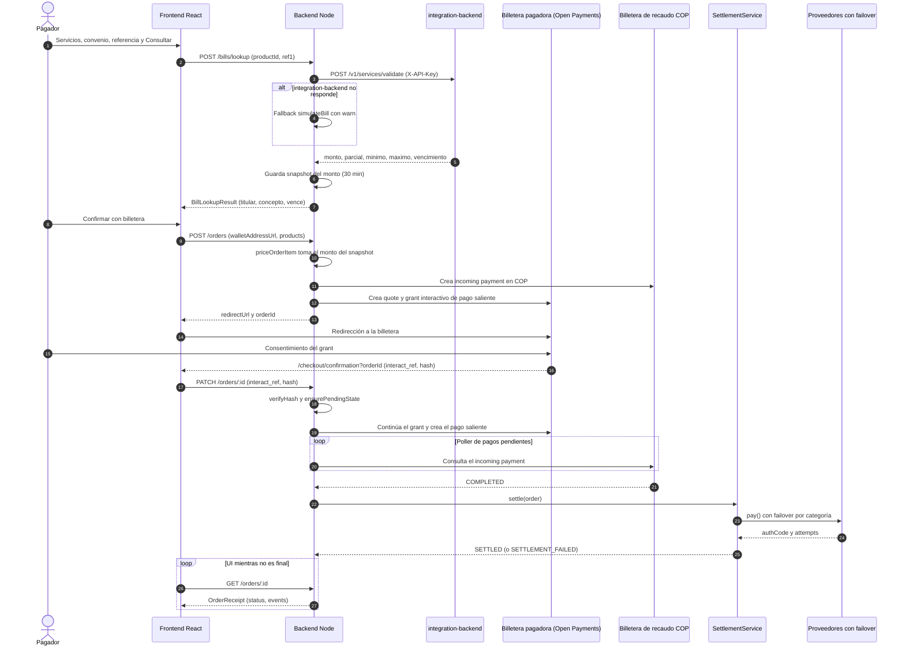

# Arquitectura

## Flujo de un pago de servicio

## Componentes

| Capa          | Ubicación                                                                                          | Responsabilidad                                                             |
| ------------- | -------------------------------------------------------------------------------------------------- | --------------------------------------------------------------------------- |
| Frontend      | `frontend/src/app/`, `frontend/src/components/insieme/`, `frontend/src/hooks/`                     | Pantallas del prototipo, tracker de estados, comprobante                    |
| Catálogo      | `backend/src/product/`, `backend/src/category/`, `backend/src/catalog/sync.ts`                     | Convenios y categorías en Postgres, sincronizados desde integration-backend |
| Facturas      | `backend/src/bill/service.ts`, `backend/src/bill/simulate.ts`, `backend/src/integration/client.ts` | Validación de referencia, snapshot del monto, fallback local                |
| Órdenes       | `backend/src/order/`, `backend/src/order-item/`                                                    | Precio autoritativo, estados y eventos                                      |
| Open Payments | `backend/src/open-payments/service.ts`, `backend/src/payment/service.ts`                           | Incoming y outgoing payments, grants, verificación del hash, poller         |
| Liquidación   | `backend/src/settlement/`                                                                          | Router de proveedores con failover, idempotencia                            |

## Decisiones

- **Un solo flujo de pago.** Servicios y facturas guardadas pasan por la misma orden, el mismo grant y el mismo tracker. No hay carrito.
- **El frontend nunca nombra al proveedor.** El campo `provider` solo sale en `GET /admin/orders`, la vista interna.
- **Fuente de verdad = incoming payment completado.** La liquidación se engancha al paso a `COMPLETED` en `PaymentService.complete()`. Un barrido reintenta órdenes `COMPLETED` sin liquidación.
- **Monto autoritativo en el servidor.** El cliente no decide el monto de una factura. El backend cobra el monto que obtuvo en la consulta (snapshot de 30 min). Para facturas libres (`kind: 'factura'`) el monto lo pone el cliente dentro de un rango, lo que se documenta como riesgo en [THREAT_MODEL.md](THREAT_MODEL.md).
- **Catálogo con respaldo.** El catálogo se sincroniza desde integration-backend cada 10 min y nunca borra filas (las órdenes las referencian). Si el integration-backend falla, se mantiene la semilla de `backend/data/catalog.json`.
- **Rutas de retorno fijas.** Open Payments vuelve a `/checkout/confirmation?orderId=` y, en el one-click, a `/cart/finish`. Las rutas se conservan del upstream.
