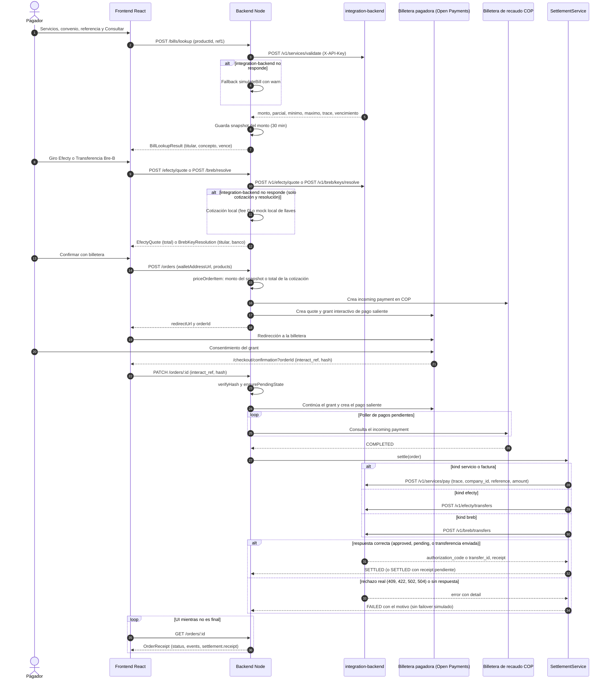

# Arquitectura

## Flujo de un pago

El pagador confirma en el frontend y el backend cobra en COP por Open Payments. Cuando el incoming payment queda `COMPLETED`, la liquidación llama al integration-backend según el tipo de producto (`kind`).

Sin integration-backend configurado (tests y modo local), la liquidación usa la cadena simulada de `backend/src/settlement/providers/index.ts`.

## Liquidación por tipo de producto

| `kind`                | Llamada al integration-backend                                                             | Evento final en la orden                                                                                                                                                                             |
| --------------------- | ------------------------------------------------------------------------------------------ | ---------------------------------------------------------------------------------------------------------------------------------------------------------------------------------------------------- |
| `servicio`, `factura` | `POST /v1/services/pay` con `trace` (o `null`), `company_id` (slug), `reference`, `amount` | "Factura pagada en Colombia". `approved` pasa a `SETTLED`; `pending` queda `SETTLED` con `receipt.status = 'pending'` y el evento "Pago en proceso en la red de recaudo"; `rejected` queda `FAILED`. |
| `efecty`              | `POST /v1/efecty/transfers`                                                                | "Giro disponible para reclamar en Efecty". `receipt` trae `instructions` y `expiresAt`.                                                                                                              |
| `breb`                | `POST /v1/breb/transfers`                                                                  | "Transferencia Bre-B enviada". `receipt` trae `holderName` y `bank`.                                                                                                                                 |

El timeout de `payService`, `efectySend` y `brebSend` es de 30 s; el resto de llamadas usa el timeout por defecto del cliente (6 s).

## Componentes

| Capa          | Ubicación                                                                                          | Responsabilidad                                                                                                 |
| ------------- | -------------------------------------------------------------------------------------------------- | --------------------------------------------------------------------------------------------------------------- |
| Frontend      | `frontend/src/app/`, `frontend/src/components/insieme/`, `frontend/src/hooks/`                     | Pantallas de servicios, giros, Bre-B y facturas; tracker de estados y comprobante                               |
| Catálogo      | `backend/src/product/`, `backend/src/category/`, `backend/src/catalog/sync.ts`                     | Convenios, giros y transferencias en Postgres, sincronizados desde integration-backend                          |
| Dinero        | `backend/src/money/`                                                                               | Cotización de Efecty (`POST /efecty/quote`) y resolución de llaves Bre-B (`POST /breb/resolve`), con mock local |
| Facturas      | `backend/src/bill/service.ts`, `backend/src/bill/simulate.ts`, `backend/src/integration/client.ts` | Validación de referencia, snapshot del monto, fallback local                                                    |
| Órdenes       | `backend/src/order/`, `backend/src/order-item/`                                                    | Precio autoritativo, estados y eventos                                                                          |
| Open Payments | `backend/src/open-payments/service.ts`, `backend/src/payment/service.ts`                           | Incoming y outgoing payments, grants, verificación del hash, poller                                             |
| Liquidación   | `backend/src/settlement/`, `backend/src/settlement/providers/integration.ts`                       | Liquidación por `kind` contra integration-backend; cadena simulada solo sin integración                         |
| Cliente HTTP  | `backend/src/integration/client.ts`                                                                | axios con `X-API-Key`; errores `HttpError {status, detail}` e `IntegrationUnavailable`                          |

## Decisiones

- **Un solo flujo de pago.** Servicios, facturas, giros y transferencias pasan por la misma orden, el mismo grant y el mismo tracker. No hay carrito. El `kind` del ítem decide a qué operación del integration-backend se llama al liquidar.
- **El frontend nunca nombra al proveedor.** El campo `provider` solo sale en `GET /admin/orders`, la vista interna.
- **Fuente de verdad = incoming payment completado.** La liquidación se engancha al paso a `COMPLETED` en `PaymentService.complete()`. Un barrido reintenta órdenes `COMPLETED` sin liquidación.
- **Sin failover ante errores reales.** Si el integration-backend rechaza una operación (409, 422, 502, 504) o no responde, la liquidación queda `FAILED` con el motivo. No se pasa a un proveedor simulado: eso fingiría un éxito tras un rechazo real. La cadena simulada solo corre cuando no hay integration-backend configurado.
- **Monto autoritativo en el servidor.** El cliente no decide el monto de una factura. El backend cobra el monto que obtuvo en la consulta (snapshot de 30 min). Para facturas libres (`kind: 'factura'`) el monto lo pone el cliente dentro de un rango, lo que se documenta como riesgo en [THREAT_MODEL.md](THREAT_MODEL.md).
- **Precio = total de la cotización.** En un giro Efecty, la orden toma el total de la cotización (monto + comisión) al crearse y lo guarda con `fee` y `total` en los detalles. La liquidación cobra ese total. El cliente no envía el total.
- **Llaves Bre-B resueltas antes de cobrar.** `POST /breb/resolve` valida la llave y devuelve el titular. Al crear la orden el backend vuelve a resolverla, guarda `keyType`, `holderName` y `bank`, y un 404 se devuelve como `errors.key`.
- **Catálogo con respaldo.** El catálogo de servicios se sincroniza desde integration-backend cada 10 min. Un convenio ausente del catálogo upstream más reciente se marca `metadata.active = false` y no se borra (las órdenes lo referencian). Si el integration-backend falla, se mantiene la semilla de `backend/data/catalog.json`. Los productos `giro` y `transferencia` no entran en esa regla.
- **Grilla solo de servicios.** `GET /catalog` devuelve solo `type = servicio` por defecto. Los giros y transferencias se piden con `GET /products?type=`.
- **Rutas de retorno fijas.** Open Payments vuelve a `/checkout/confirmation?orderId=` y, en el one-click, a `/cart/finish`. Las rutas se conservan del upstream.
