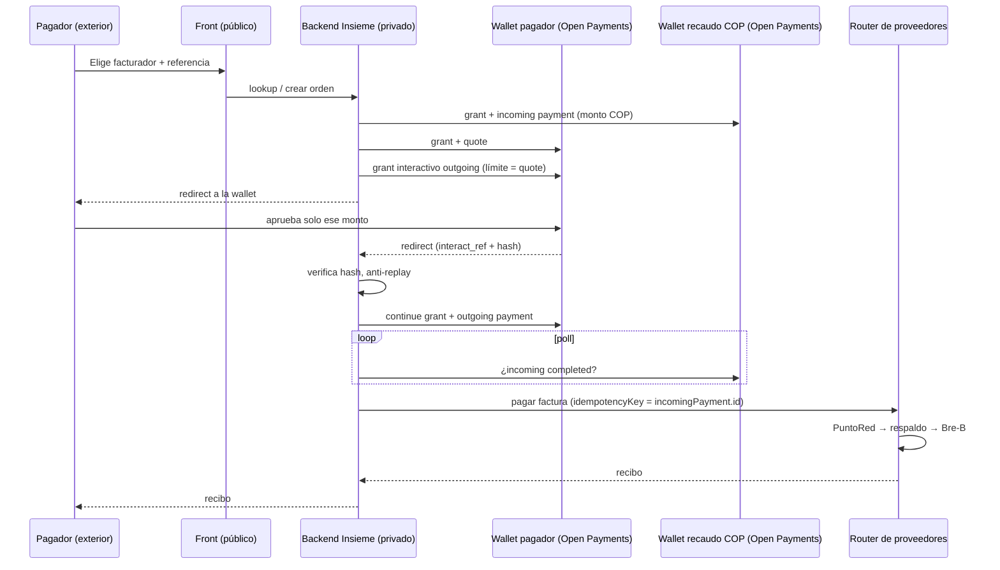

# Arquitectura

## Decisiones
1. **Un solo flujo** (pagar una factura). El envío a wallet de la madre y el "allowance" quedan como extensión.
2. **El front no nombra al proveedor** (consejo de Roberto): el router elige y hace failover; solo `/api/admin` lo expone.
3. **La fuente de verdad para pagar al corresponsal es el incoming payment completado**, no el redirect del navegador.
4. **Monto autoritativo en servidor**: se reconsulta la factura al crear la orden.
5. **Liquidez (no implementada):** prefondeo en la red de recaudo y reposición por lotes con lo recibido vía Interledger.
